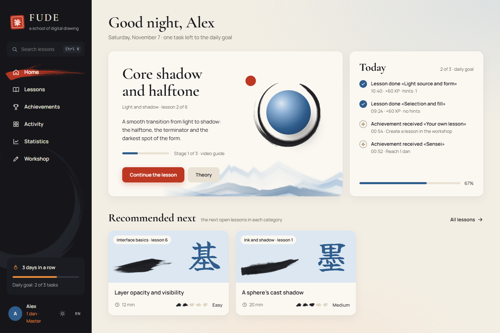
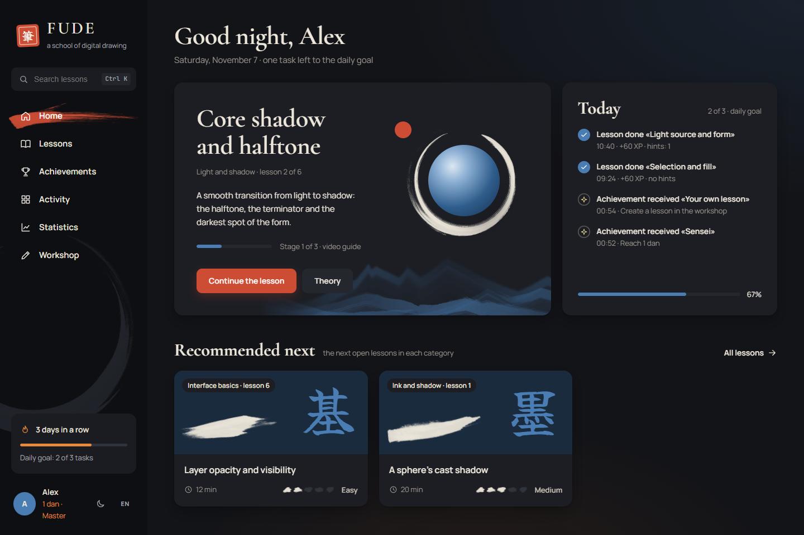
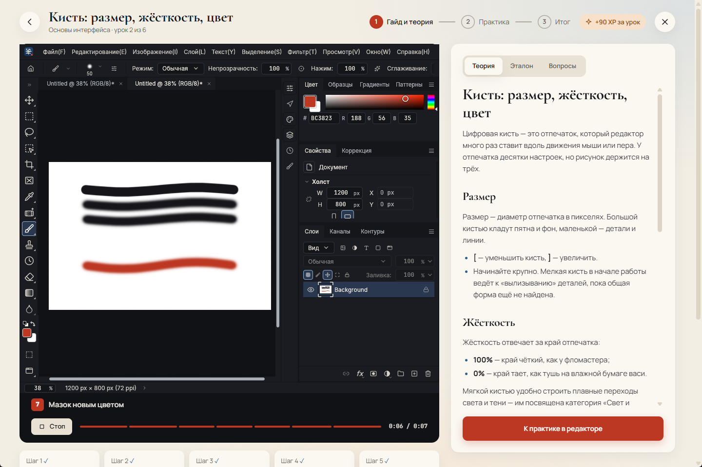
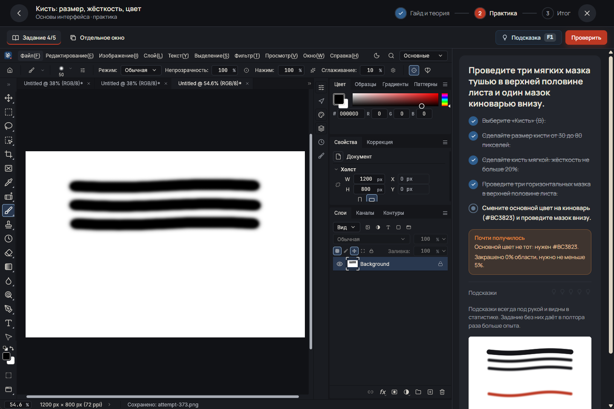
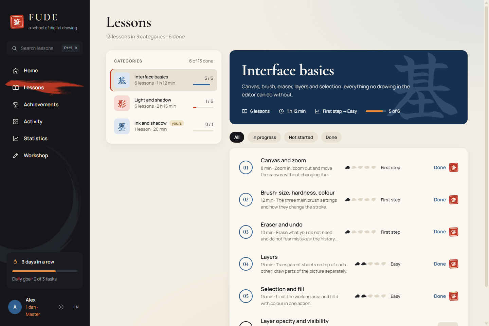
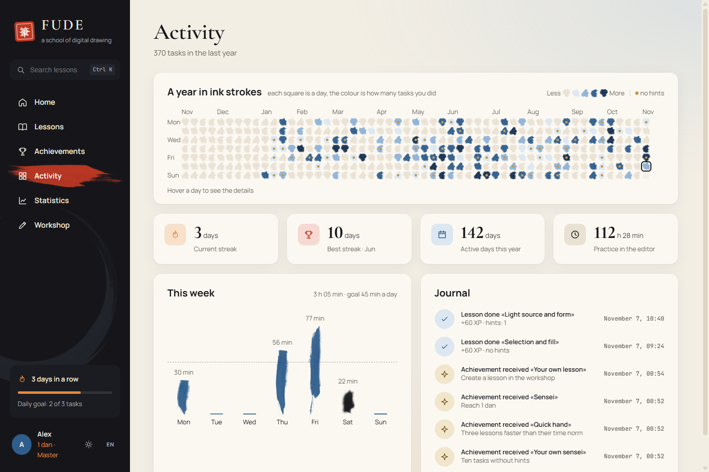
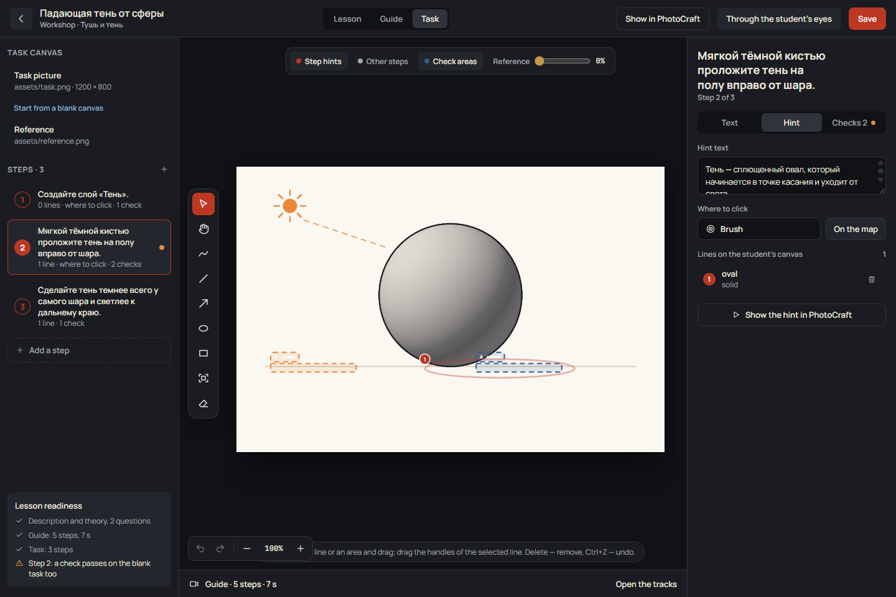
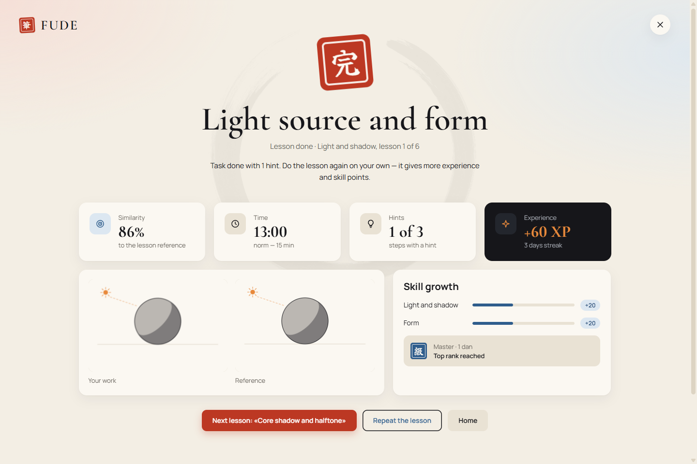
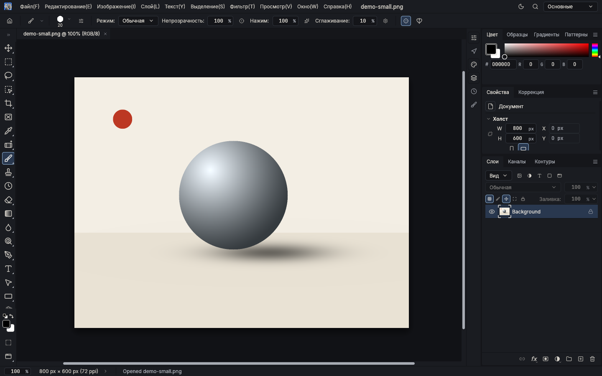
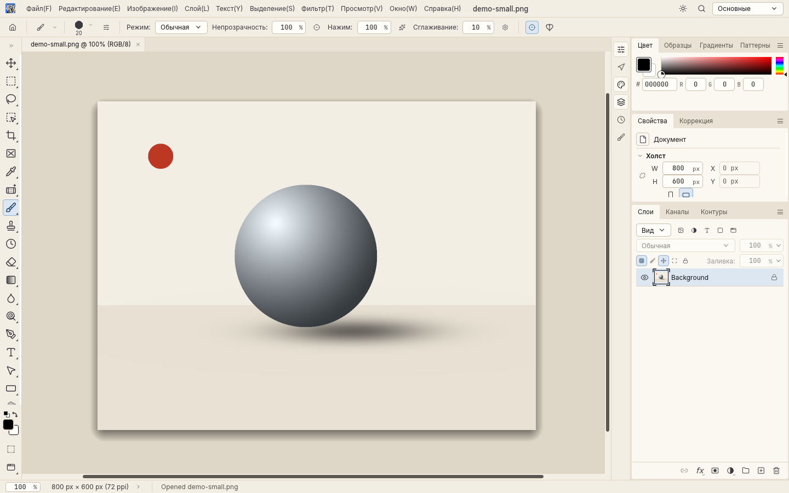

# FUDE 筆

[Русский](README.md) · **English**

**FUDE** ("brush" in Japanese) is an app that teaches digital drawing in a graphics editor. The model is Photoshop; the editor itself is the open-source [PhotoCraft](https://github.com/storytold/photocraft), restyled in the FUDE look: Japanese ink painting, washi paper, indigo and vermilion.

A diploma project (4th year).

<p align="center">
  
  
</p>
<p align="center">
  
  
</p>
<p align="center">
  
  
</p>
<p align="center">
  
  
</p>
<p align="center">
  
  
</p>

## What it is

The student picks a category and a lesson, watches an animated guide, reads the theory and does the task right in the built-in editor. The editor runs inside the FUDE window with a slide-out task panel, which suits one small screen, or in its own window if two monitors are handier. Your own lessons and categories are made in the lesson studio, where you see what you are doing on the task canvas: hint lines, check areas, the reference on top, the guide on timeline tracks, a live check and a "through the student's eyes" preview. Other people's lessons are imported from a `.fude` file. Everything works locally, without accounts. Hint mode shows where to click and draws a ghost shape on the canvas; using hints counts in the statistics. Progress shows on the Achievements, Activity (by day, like GitHub) and Statistics (growth of separate skills) tabs. There are two themes, light «Washi» and dark «Sumi»; the strokes, ensō and mountains in the interface are real ink strokes, not shapes drawn in code.

The interface, the built-in lessons and the documentation are available in Russian and English.

More on the product, audience and limits — in [PRODUCT.en.md](PRODUCT.en.md).

## What is done

| Part | State | Where |
|---|---|---|
| Figma mockup of every screen: 13 screens including first-day and error states, the dark theme, the lesson studio | done | [docs/en/design-system.md](docs/en/design-system.md) |
| Design system: colours, fonts, components, motion | done | [docs/en/design-system.md](docs/en/design-system.md) |
| Opening animation (3.6 s) on Figma keyframes | done | [design/fude-splash.mp4](design/fude-splash.mp4) |
| Editor: PhotoCraft with the FUDE Sumi and FUDE Washi themes | done, tests pass | [docs/en/editor.md](docs/en/editor.md) |
| ArtCraft trademarks removed from the editor | done | [docs/en/editor.md](docs/en/editor.md) |
| Editor with no ties to the PhotoCraft repository: no update checks or network requests, links only to FUDE | done, tests | [docs/en/editor.md](docs/en/editor.md) |
| Editor in the FUDE window or in its own window (Windows) | works | [docs/en/app.md](docs/en/app.md) |
| Lesson and `.fude` package format | done | [docs/en/lesson-format.md](docs/en/lesson-format.md) |
| Lesson core `fude-core`: library, task checks, guides, hints, live check, guide recording, import and export; CLI `fude-cli` | done, 112 tests | [core/](core/), [docs/en/architecture.md](docs/en/architecture.md) |
| Built-in lessons: «Interface basics» and «Light and shadow», 12 lessons | done | [lessons/](lessons/) |
| App: Tauri + SvelteKit, every mockup screen, practice in PhotoCraft with auto-check and hints, progress in SQLite, lesson workshop | works, 52 + 67 tests | [app/](app/), [docs/en/app.md](docs/en/app.md) |
| Lesson studio: task canvas, hint lines, check areas, guide on timeline tracks, guide recording from PhotoCraft, live check | works | [docs/en/app.md](docs/en/app.md) |
| «Washi» and «Sumi» themes, toggle next to the profile | done | [docs/en/design-system.md](docs/en/design-system.md) |
| Ink from real strokes (Sumi Strokes brushes): menu strokes, ensō, mountains, the activity year | done | [docs/en/design-system.md](docs/en/design-system.md) |
| Two languages, Russian and English: interface, messages, editor, built-in lessons, documentation | done, tests | [docs/en/app.md](docs/en/app.md#language) |

## Repository layout

```text
FUDE/
├── README.md          this file in Russian (README.en.md — in English)
├── LICENSE            MIT for FUDE's own code and materials
├── PRODUCT.md         the product: users, goals, features, open questions (PRODUCT.en.md)
├── CHANGELOG.md       what changed (CHANGELOG.en.md — in English)
├── Cargo.toml         Rust workspace for FUDE's own code
├── core/              the lesson core fude-core and the fude-cli CLI
├── app/               the app: interface (SvelteKit) and backend (Tauri, src-tauri/)
├── lessons/           built-in lessons: basics, light
├── docs/              FUDE documentation
│   ├── architecture.md   how the app works and how the editor is embedded
│   ├── app.md            the app: running, screens, practice, experience and ranks
│   ├── lesson-format.md  lessons, checks, guides and .fude packages
│   ├── design-system.md  colours, fonts, components, mockup screens, motion
│   ├── editor.md         what was changed in PhotoCraft and why
│   ├── build.md          how to build and run the editor on Windows
│   ├── testing.md        which tests exist and how to run them
│   ├── contributing.md   branches, commits, how to contribute
│   ├── roadmap.md        the work plan
│   └── en/               the same documents in English
├── design/            mockup materials: splash video, screenshots, icon and ink generators
└── photocraft/        the editor: a copy of storytold/photocraft@c65b5d2 with FUDE changes
```

## Quick start

You need Rust 1.99+, Visual Studio Build Tools with the C++ component and Node.js 20+ (details in [docs/en/build.md](docs/en/build.md) and [docs/en/app.md](docs/en/app.md)).

```bash
cd photocraft
cargo build --release -p photocraft   # the editor, once
cd ../app
npm install
npm run tauri dev                     # the FUDE app
```

GitHub Actions builds the Windows installer ([`build.yml`](.github/workflows/build.yml)): on every push to `main`, on a `v*` tag (then also a release) or by hand. The files are in the `FUDE-windows-x64` artifact on the run page: `.exe` and `.msi` installers and a portable `.zip`. Tests and clippy run on every push ([`ci.yml`](.github/workflows/ci.yml)).

To launch with a click: [`app/run-dev.cmd`](app/run-dev.cmd) does the same in a minimised console (and runs `npm install` if needed). A shortcut to it with the `app/src-tauri/icons/icon.ico` icon is handy; closing the FUDE window stops everything.

On first launch FUDE asks for a name and a daily goal, and the interface language. Practice opens PhotoCraft in the FUDE Sumi theme right in the FUDE window; the "Separate window" button moves it to its own window, "Embed in FUDE window" brings it back. The light FUDE Washi theme is in the editor menu **Window › Theme › Light Theme**.

Check the built-in lessons and run the core tests (from the repository root):

```bash
cargo run -p fude-core --bin fude-cli -- validate lessons
cargo test -p fude-core
```

Editor theme and brand tests:

```bash
cd photocraft
cargo test -p photocraft-ui-egui --lib theme::
cargo test -p photocraft-engine --lib prefs
```

The full list of tests is in [docs/en/testing.md](docs/en/testing.md).

## Branches

- **`main`** — finished versions only.
- **`SelfKnowledge`** — development. Everything new lands here and reaches `main` by merging a finished version.

See [docs/en/contributing.md](docs/en/contributing.md).

## Licences

- FUDE's own code and materials (lesson core, lessons, documentation, design materials, the app) — **MIT**, see [LICENSE](LICENSE).
- The ink pictures in [`app/src/lib/assets/ink/`](app/src/lib/assets/ink/ATTRIBUTION.md) (strokes, ensō, mountains) are made from the «Sumi Strokes» brushes (SparkleStock) and fall under the SparkleStock licence, not MIT; details in `ATTRIBUTION.md` next to them.
- The editor in [`photocraft/`](photocraft/) keeps its own licence, **MIT OR Apache-2.0**, like the original PhotoCraft. See [photocraft/LICENSE-MIT](photocraft/LICENSE-MIT), [photocraft/LICENSE-APACHE](photocraft/LICENSE-APACHE) and [photocraft/NOTICE](photocraft/NOTICE). The original authors' copyright line is kept, as those licences require.
- ArtCraft's name, logos and links were removed from the editor under the brand terms for forks. They remain trademarks of the ArtCraft Team.

FUDE is not affiliated with Adobe. Photoshop is a trademark of Adobe Inc.; the name is used only to describe what the editor resembles.
