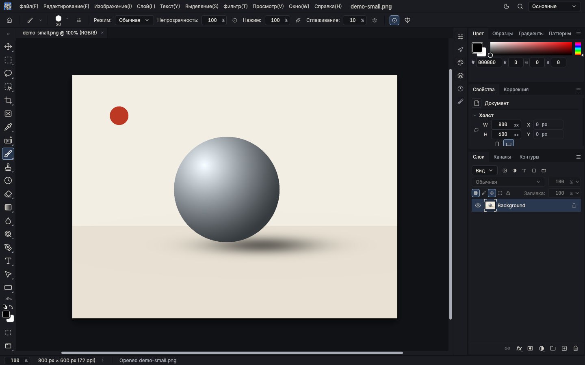
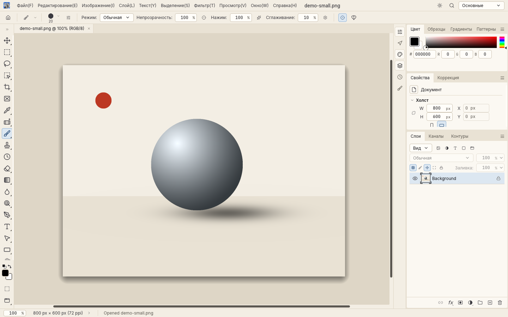
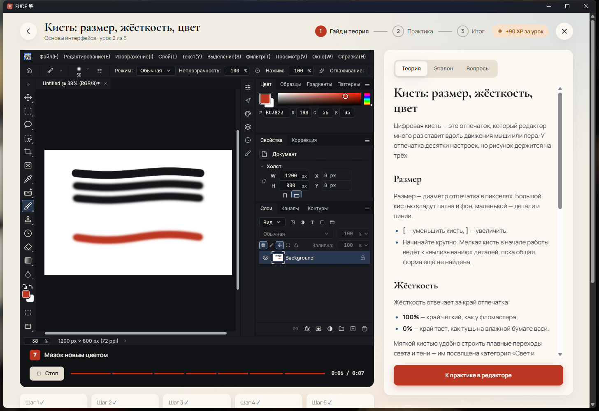
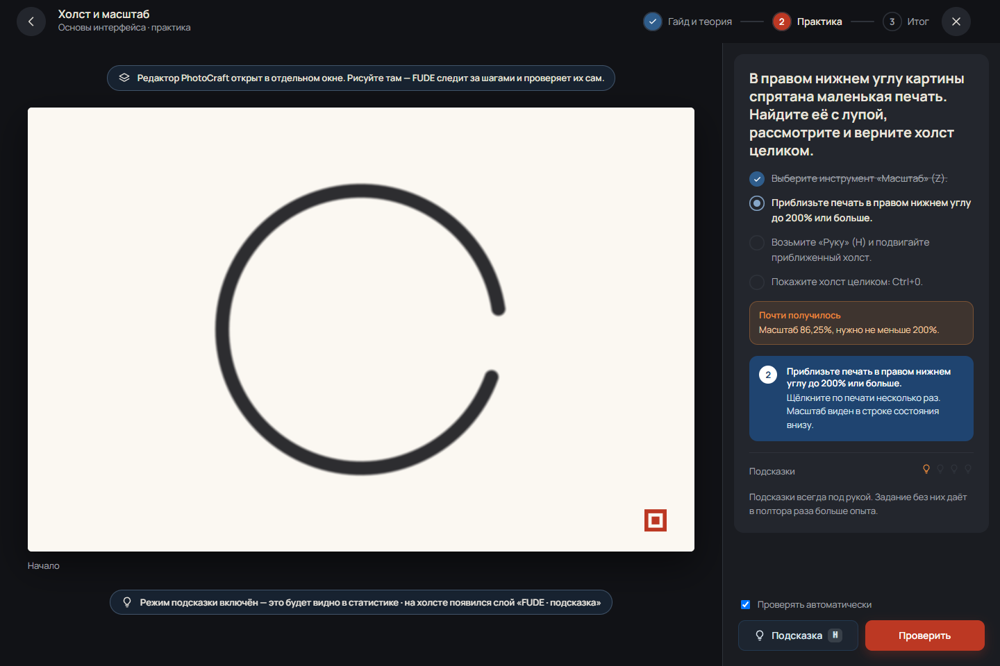
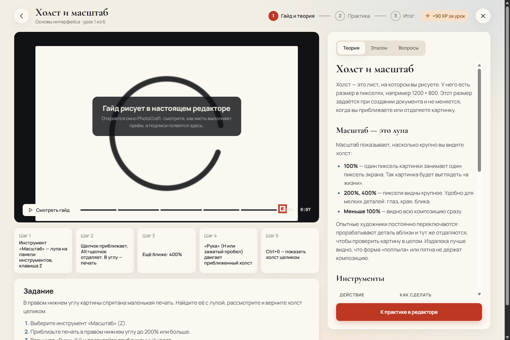
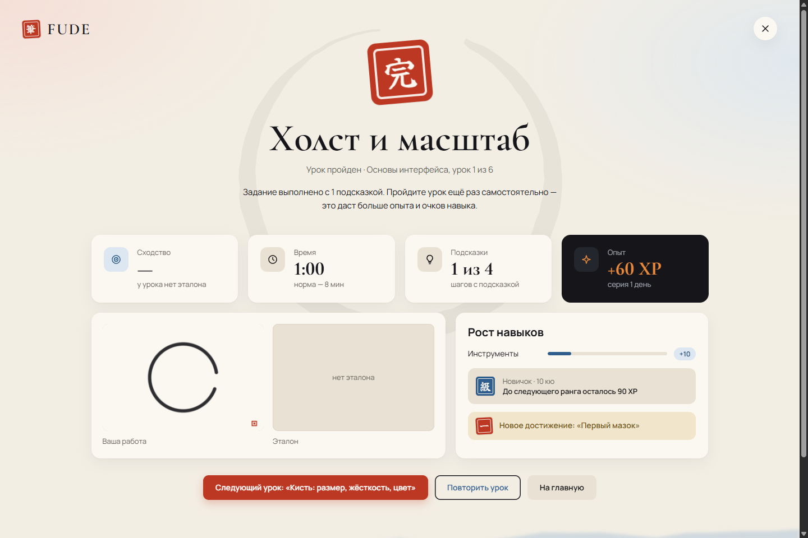

# FUDE 筆

**FUDE** («кисть» по-японски) — приложение для обучения цифровому рисунку в графическом редакторе. За образец взят Photoshop, а сам редактор — открытый [PhotoCraft](https://github.com/storytold/photocraft), перекрашенный в стиль FUDE: японская живопись тушью, бумага васи, индиго и киноварь.

Дипломный проект (4 курс).

<p align="center">
  
  
</p>

<p align="center">
  
  
</p>
<p align="center">
  
  
</p>

## Что это

Ученик выбирает категорию и урок, смотрит анимированный видеогайд, читает теорию и выполняет задание прямо во встроенном редакторе. Редактор работает внутри окна FUDE с выдвижной панелью задания — удобно на одном небольшом экране — или отдельным окном, если удобнее два монитора. Свои уроки и категории можно создавать в редакторе уроков, а чужие — импортировать из файла `.fude`. Всё работает локально, без учётных записей. Режим подсказки показывает, куда нажать, и рисует на холсте теневую фигуру. Использование подсказок учитывается в статистике. Прогресс видно на вкладках «Достижения», «Активность» (по дням, как на GitHub) и «Статистика» (рост отдельных сторон навыка).

Подробно о продукте, аудитории и ограничениях — в [PRODUCT.md](PRODUCT.md).

## Что уже сделано

| Часть | Состояние | Где |
|---|---|---|
| Макет всех экранов в Figma: 13 экранов, включая состояния первого дня и ошибок | готов | [docs/design-system.md](docs/design-system.md) |
| Дизайн-система: цвета, шрифты, компоненты, движение | готова | [docs/design-system.md](docs/design-system.md) |
| Анимация открытия (3,6 с) на ключевых кадрах Figma | готова | [design/fude-splash.mp4](design/fude-splash.mp4) |
| Редактор: PhotoCraft с темами FUDE Тушь и FUDE Васи | готов, тесты проходят | [docs/editor.md](docs/editor.md) |
| Удаление товарных знаков ArtCraft из редактора | сделано | [docs/editor.md](docs/editor.md#товарные-знаки-artcraft) |
| Редактор без связи с репозиторием PhotoCraft: без проверки обновлений и сетевых запросов, ссылки только на FUDE | сделано, тесты | [docs/editor.md](docs/editor.md#3-без-связи-с-репозиторием-photocraft) |
| Редактор в окне FUDE или отдельным окном (Windows) | работает | [docs/app.md](docs/app.md#редактор-в-окне-fude-или-отдельно) |
| Формат уроков и пакетов `.fude` | готов | [docs/lesson-format.md](docs/lesson-format.md) |
| Ядро уроков `fude-core`: библиотека, проверка заданий, гайды, подсказки, импорт и экспорт, редактор уроков; CLI `fude` | готово, 93 теста | [core/](core/), [docs/architecture.md](docs/architecture.md) |
| Встроенные уроки: «Основы интерфейса» и «Свет и тень», 12 уроков | готовы | [lessons/](lessons/) |
| Приложение: Tauri + SvelteKit, все экраны макета, практика в PhotoCraft с автопроверкой и подсказками, прогресс в SQLite, мастерская уроков | работает, 24 + 24 теста | [app/](app/), [docs/app.md](docs/app.md) |

## Структура репозитория

```text
FUDE/
├── README.md          этот файл
├── LICENSE            MIT для собственного кода и материалов FUDE
├── PRODUCT.md         продукт: пользователи, цели, функции, открытые вопросы
├── CHANGELOG.md       что менялось
├── Cargo.toml         рабочее пространство Rust для собственного кода FUDE
├── core/              ядро уроков fude-core и CLI fude
├── app/               приложение: интерфейс (SvelteKit) и бэкенд (Tauri, src-tauri/)
├── lessons/           встроенные уроки: basics, light
├── docs/              документация FUDE
│   ├── architecture.md   как устроено приложение и как в него встраивается редактор
│   ├── app.md            приложение: запуск, экраны, практика, опыт и ранги
│   ├── lesson-format.md  формат уроков, проверок, гайдов и пакетов .fude
│   ├── design-system.md  цвета, шрифты, компоненты, экраны макета, движение
│   ├── editor.md         что изменено в PhotoCraft и почему
│   ├── build.md          как собрать и запустить редактор на Windows
│   ├── testing.md        какие есть тесты и как их запускать
│   ├── contributing.md   ветки, коммиты, как вносить изменения
│   └── roadmap.md        план работ
├── design/            материалы макета: видео заставки, скриншоты редактора
└── photocraft/        редактор: копия storytold/photocraft@c65b5d2 с изменениями FUDE
```

## Быстрый старт

Нужны Rust 1.95+, Visual Studio Build Tools с компонентом C++ и Node.js 20+ (подробно — в [docs/build.md](docs/build.md) и [docs/app.md](docs/app.md)).

```bash
cd photocraft
cargo build --release -p photocraft   # редактор, один раз
cd ../app
npm install
npm run tauri dev                     # приложение FUDE
```

Запускать кликом: [`app/run-dev.cmd`](app/run-dev.cmd) делает то же самое в свёрнутой консоли (и `npm install`, если нужно). На него удобно сделать ярлык с иконкой `app/src-tauri/icons/icon.ico`; закрытие окна FUDE останавливает всё.

При первом запуске FUDE спросит имя и цель дня. Практика открывает PhotoCraft в теме FUDE Тушь прямо в окне FUDE; кнопка «Отдельное окно» выносит его в своё окно, «Встроить в окно FUDE» — возвращает. Светлая тема FUDE Васи переключается в меню редактора **Window › Theme › Light Theme**.

Проверить встроенные уроки и запустить тесты ядра (из корня репозитория):

```bash
cargo run -p fude-core --bin fude -- validate lessons
cargo test -p fude-core
```

Тесты тем и бренда редактора:

```bash
cd photocraft
cargo test -p photocraft-ui-egui --lib theme::
cargo test -p photocraft-engine --lib prefs
```

Полный список тестов — в [docs/testing.md](docs/testing.md).

## Ветки

- **`main`** — только готовые версии.
- **`SelfKnowledge`** — разработка. Всё новое попадает сюда, в `main` — через слияние готовой версии.

Порядок работы описан в [docs/contributing.md](docs/contributing.md).

## Лицензии

- Собственный код и материалы FUDE (ядро уроков, уроки, документация, материалы дизайна, будущее приложение) — **MIT**, см. [LICENSE](LICENSE).
- Редактор в папке [`photocraft/`](photocraft/) остаётся под своей лицензией **MIT OR Apache-2.0**, как и исходный PhotoCraft. См. [photocraft/LICENSE-MIT](photocraft/LICENSE-MIT), [photocraft/LICENSE-APACHE](photocraft/LICENSE-APACHE) и [photocraft/NOTICE](photocraft/NOTICE). Строка копирайта исходных авторов сохранена, как того требуют эти лицензии.
- Название, логотипы и ссылки ArtCraft удалены из редактора по условиям бренда для форков. Они остаются товарными знаками ArtCraft Team.

FUDE не связан с Adobe. Photoshop — товарный знак Adobe Inc.; название используется только для описания того, на что похож редактор.
